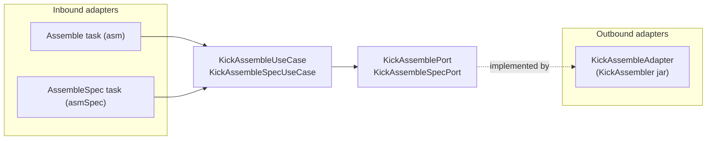

# Building Block: compilers

[← Back to §5 Building Block View](../05_building_block_view.md)

## Purpose

The `compilers` context turns assembly source into binary artifacts (PRG and related formats) for MOS 65xx targets. It contains two independent sub-domains:

- **`compilers:kickass`** — the primary dialect: [Kick Assembler](../12_glossary.md). Also owns downloading the KickAssembler jar as a dev dependency, spec (test) assembly, and build-artefact cleanup.
- **`compilers:dasm`** — the [DASM](../12_glossary.md) dialect, driven as an external command-line tool. Also owns downloading the per-OS dasm binary from the official GitHub releases (opt-in via `retroProject.dasmVersion`).

## Use cases

| Use case | Sub-domain | `apply` payload → result | Responsibility |
|----------|-----------|--------------------------|----------------|
| `KickAssembleUseCase` | kickass | `KickAssembleCommand` → `Unit` | Assemble a source file into the configured output format |
| `KickAssembleSpecUseCase` | kickass | spec command → `Unit` | Assemble a 64spec test source for emulator execution |
| `DownloadKickAssemblerUseCase` | kickass | download command → `Unit` | Download the KickAssembler jar (if the version changed) |
| `GenerateKickAssSourceUseCase` | kickass | source-gen payload | Generate KickAss source fragments |
| `CleanBuildArtefactsUseCase` | kickass | pattern → `Unit` | Delete build artefacts matching a glob |
| `DasmAssembleUseCase` | dasm | `DasmAssembleCommand` → `Unit` | Assemble a source file via the DASM CLI |
| `DownloadDasmUseCase` | dasm | `DownloadDasmCommand` → `Unit` | Download and unpack the per-OS dasm binary (if the version changed) |

## Ports

| Port | Direction | Implementing adapter | Path |
|------|-----------|----------------------|------|
| `KickAssemblePort` | out | `KickAssembleAdapter` | `compilers/kickass/adapters/out/gradle/.../KickAssembleAdapter.kt` |
| `KickAssembleSpecPort` | out | `KickAssembleSpecAdapter` | `compilers/kickass/adapters/out/gradle/.../KickAssembleSpecAdapter.kt` |
| `DownloadKickAssemblerPort` | out | `DownloadKickAssemblerAdapter` | `compilers/kickass/adapters/out/filedownload/.../DownloadKickAssemblerAdapter.kt` |
| `ReadVersionPort` / `SaveVersionPort` | out | `ReadVersionAdapter` / `SaveVersionAdapter` | `compilers/kickass/adapters/out/gradle/...` |
| `DeleteFilesPort` | out | `DeleteFilesAdapter` | `compilers/kickass/adapters/out/gradle/.../DeleteFilesAdapter.kt` |
| `DasmAssemblePort` | out | `DasmAssembleAdapter` | `compilers/dasm/adapters/out/gradle/.../DasmAssembleAdapter.kt` |
| `DownloadDasmPort` | out | `DownloadDasmAdapter` | `compilers/dasm/adapters/out/filedownload/.../DownloadDasmAdapter.kt` |
| `UnpackZipPort` | out | `UnpackZipAdapter` | `compilers/dasm/adapters/out/filedownload/.../UnpackZipAdapter.kt` |
| `ReadVersionPort` / `SaveVersionPort` (dasm) | out | `ReadVersionAdapter` / `SaveVersionAdapter` | `compilers/dasm/adapters/out/gradle/...` |

## Adapters

**Inbound (kickass, Gradle tasks):** `Assemble` (`asm`), `AssembleSpec` (`asmSpec`), `Clean` (`clean`), `ResolveDevDeps` (`resolveDevDeps`) — in `compilers/kickass/adapters/in/gradle/`. Each Gradle task holds its injected use case and calls `apply` during task execution.

**Outbound (kickass):** `KickAssembleAdapter` invokes the KickAssembler jar via a `CommandLineBuilder`; `DownloadKickAssemblerAdapter` uses the shared `FileDownloader`; version adapters persist the resolved dialect version.

**Inbound (dasm, Gradle tasks):** `DasmAssemble` (`asm` when `retroProject.dialect = Dasm`) and `ResolveDasm` (`resolveDasm`, registered only when `dasmVersion` is set) — in `compilers/dasm/adapters/in/gradle/`.

**Outbound (dasm):** `DasmAssembleAdapter` builds a DASM command line via `DasmCommandLineBuilder` and executes the binary resolved in `DasmAssemblerSettings` (explicit `dasmExecutable` → downloaded `{workDir}/asms/dasm/{version}/` binary → `dasm` on PATH). `DownloadDasmAdapter`/`UnpackZipAdapter` fetch and unpack the release zip; version adapters persist the cached binary version. DASM is also reachable through the `flows` context's `DasmAssemblyPort` (see [flows.md](flows.md)).

**Dialect selection:** `RetroAssemblerPlugin.wireSources` branches on `retroProject.dialect`: `Dasm` wires the `asm` task to `DasmAssembleUseCase` (dependencies: `downloadDeps`, `preprocess`, and `resolveDasm` when present — not `resolveDevDeps`); any other value keeps the KickAssembler wiring. Under the `Dasm` dialect the 64spec tasks (`asmSpec`, `test`) are registered as no-op tasks that log a warning, since 64spec requires KickAssembler.

## Hexagon

